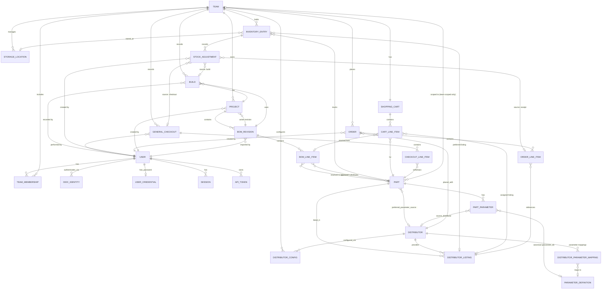

# partrack — Conceptual Data Model

> This document describes the core entities partrack needs to store and their relationships.
> Auditing (user attribution on events) is acknowledged as a future concern and is excluded here.
> May be out of date with the actual code base. Always check schema definitions in /db to cross check.

---

## Design Principles

- **Parts are a catalog, not just stock records.** A Part can exist in the system with zero inventory — it is created when first encountered (during BOM import, manual entry, or order receipt). What the team physically owns is tracked separately in Inventory Entries.
- **An Inventory Entry is a team's profile for a part, not just a stock record.** It exists to hold team-specific configuration — preferred storage location, preferred distributor listing, and stock history — independently of whether there is currently any stock on hand. An entry with quantity zero is meaningful and expected.
- **Inventory is a ledger, not just a counter.** Quantity on hand is the result of recorded events (receipts, manual adjustments). The full history of those events is kept.
- **Parts are never deleted.** Instead, they are marked with a lifecycle status (e.g. Obsolete, Deprecated, No Longer Available). This preserves historical references from BOMs, orders, and inventory.
- **BOMs describe intent; inventory describes reality.** A BOM line item may or may not be resolved to a specific part. Stock checking bridges these two worlds.
- **Orders are a procurement record.** They are not directly tied to a single BOM; they reflect what was actually purchased and from where.
- **One manufacturer part number, many distributor listings.** A single Part (MPN) may be available from multiple distributors, and from a single distributor in multiple packaging types — each combination is a distinct Distributor Listing with its own pricing and ordering constraints.
- **Parameter data from multiple sources coexist.** Distributor APIs may disagree on parameter values. All data is retained, user-specified values always take precedence, and a per-part preferred source can be designated to resolve conflicts between distributor sources. Each parameter is normalised against a canonical **parameter registry** and, where numeric, parsed into a base-SI value — so parts can be filtered and compared by parameter regardless of which distributor supplied the raw text.

---

## Entities

### Team
The top-level organisational unit. A team owns projects, inventory, and orders. In a single-user deployment, there is simply one team.

Key data:
- Name, description
- Distributor configurations (which distributors are enabled, what credentials to use, and caching policy)
- Storage locations

---

### Project
A PCB design effort. Projects belong to a Team.

Key data:
- Name, description
- Status (e.g. active, archived, completed)
- A pointer to the *active* BOM revision (the one used for stock checking)
- **BOM import config** — optional opaque JSON blob storing the column-mapping configuration last used when importing a BOM CSV into this project. Set by the frontend during import; used to pre-populate the column mapping UI on subsequent imports. Null until the first import that supplies a config.
- **Created by** — reference to the User who created the project

Build quantity is **not** stored on the Project. It is an ephemeral parameter supplied by the user when running a stock check or populating the cart, and is recorded on a Build event when boards are actually assembled (see *Build*).

---

### BOM Revision
A versioned snapshot of a bill of materials, associated with a Project. Multiple revisions exist to support design iteration (Rev A, Rev B, etc.).

Key data:
- Revision label / name (e.g. `v1.0`, `Rev B`)
- Import timestamp
- Optional notes / changelog entry
- **Imported by** — reference to the User who imported this revision

---

### BOM Line Item
A single row in a BOM revision, representing one logical component requirement.

Key data:
- Reference designators (e.g. `R1, R3, R7`)
- Required quantity
- Raw component description as imported (kept verbatim for traceability)
- Optional link to a resolved **primary Part**
- Set of **approved substitute Parts** — other Parts accepted as equivalent for this line item

**Resolution process:**
When a BOM is imported, the system attempts to auto-resolve each line item to a Part:
1. If the line item contains an MPN, search the Part catalog for an exact match.
2. If the line item contains a distributor SKU, search Distributor Listings for a match and follow the link to the parent Part.
3. If no catalog match is found but an MPN is present, query the configured distributor APIs to look up and import the Part automatically (see *Part Creation* below).
4. If auto-resolution fails, the line item remains **unresolved** until the user manually links it.

Stock checking is only performed for resolved line items. Unresolved items are surfaced to the user as gaps requiring attention.

---

### Part
The central entity of the system. Represents a specific, identifiable component, ideally at the manufacturer part number (MPN) level. Parts exist in the catalog independently of whether any stock is held.

**Parts are never deleted.** When a part is discontinued or removed from use, its lifecycle status is updated accordingly.

Key data:
- **Scope**: `global` (available to all teams, typically populated from distributor APIs) or `team` (created by a specific team, e.g. user-defined or salvaged parts without a known MPN)
- **Team reference** — only populated when scope is `team`
- Manufacturer part number (MPN) — may be absent for team-scoped user-defined parts
- Manufacturer name
- Human-readable description
- Category (e.g. Resistor, Capacitor, MCU, Connector)
- Package / footprint (e.g. `0402`, `SOT-23`, `SOIC-8`)
- Datasheet URL
- **Lifecycle status** (e.g. Active, NRND, Obsolete, Deprecated, No Longer Available)
- Enrichment source (which distributor API populated this record) and timestamp
- **Preferred parameter source** — an optional reference to a Distributor. When set, only parameter entries sourced from this distributor are used when distributor-sourced values are needed (e.g. for substitution matching). User-specified parameters always take precedence regardless of this setting. When not set, all distributor-sourced parameters are available but conflicts between sources may produce ambiguous results.

A Part has:
- A set of **Part Parameters**
- One or more **Distributor Listings**

**Part Creation — three entry points:**

| Trigger | Mechanism |
|---|---|
| BOM import | If a line item carries an MPN not yet in the catalog, the system queries active distributor APIs and imports the Part along with its Distributor Listings. An Inventory Entry (with zero quantity) is created for the team so preferences can be recorded immediately. |
| Manual entry | The user explicitly adds a Part (global or team-scoped) with whatever data they have. |
| Order receipt | If an ordered part is somehow not yet in the catalog, it is created during the receiving flow and its Inventory Entry is created simultaneously. |

---

### Part Parameter
A structured key-value attribute of a Part.

Multiple entries for the **same parameter** may exist for a single Part when different sources (distributor APIs) report different values. All such entries are retained. The effective value used by the system is determined by the following precedence:

1. **User-specified** entries always win and are never overridden.
2. If the Part has a `preferred_parameter_source` set, only entries from that distributor source are used for distributor-sourced values.
3. If no preferred source is set, entries from all distributor sources are available; the system may surface conflicts to the user.

Key data:
- **Raw name** — the parameter name as supplied by the source (distributor text such as `Resistance` or `Resistance (Ohms)`, or the key typed by a user).
- **Canonical parameter** (`parameter_id`) — an optional reference to a **Parameter Definition** (below). Distributor values are mapped during enrichment via the Distributor Parameter Mapping; user values are resolved on write — inheriting a same-named distributor entry's mapping, or matching the registry by slug / display name. May be null for unmapped distributor params and free-text user params.
- **Value** — the original text (e.g. `10k`, `50V`, `100n`).
- **Numeric value(s)** (`numeric_value`, `numeric_value_max`) — the value parsed into base SI units (e.g. `10000` for `10k`), populated for numeric/range parameters once the canonical parameter is known. This is what powers value-based filtering and comparison; `numeric_value_max` carries the upper bound of a range. Null for text/enum/enum_set parameters and unparseable values.
- **Enum members** (`enum_values`, text[]) — the parsed member list for `enum_set` parameters (e.g. `{CANbus, EBI/EMI, Ethernet}`), GIN-indexed for contains-any membership search. Null for all other kinds.
- Unit (e.g. `Ω`, `V`, `F`)
- **Source type**: `user` or `distributor`
- **Source distributor** — reference to the Distributor that provided this value (only present when source type is `distributor`)

Because the searchable representation (`parameter_id` + `numeric_value`) is computed on **every** write path — distributor enrichment and manual user entry alike — a user override participates in parameter columns and value search identically to the distributor value it supersedes. The user-wins precedence above therefore holds for search and comparison, not just display.

---

### Parameter Definition
A canonical, system-level parameter in the **parameter registry** — the normalised identity that distributor-specific and user-entered parameter names map onto. Global and shared across all teams; seeded with a standard electronics set and extensible by instance admins.

Key data:
- **Slug** — stable key (e.g. `resistance`, `voltage_rating`, `capacitance`)
- **Display name** (e.g. `Resistance`)
- **Unit** and **unit symbol** — base SI unit identifier and display symbol (e.g. `ohm` / `Ω`)
- **Value type** — `numeric`, `range`, `text`, `enum`, or `enum_set`; determines how the raw value is parsed. `numeric`/`range` parse into `numeric_value`(`_max`) (SI-normalised, with handling for fractions, dual-unit, point/conditional specs, and ppm/ppb); `enum_set` (a list value like `CANbus, EBI/EMI, Ethernet`) parses into the `enum_values` text[] for contains-any membership search

---

### Distributor Parameter Mapping
Maps a distributor's own parameter identifier to a Parameter Definition. Global, system-level. Rows are created automatically as enrichment encounters new distributor parameters (initially unmapped, awaiting admin review) and are curated by instance admins. This replaces the earlier notion of a hardcoded / config-file name mapping — the mapping is now first-class data.

Key data:
- **Distributor** and **distributor parameter id / name** — the source-side identity
- **Parameter** (`parameter_id`) — the canonical definition it maps to; null while unmapped
- **Ignored** — flag to suppress an irrelevant distributor parameter from the review queue

---

### Distributor
A known electronics distributor. Global, system-level entity.

Key data:
- Name (e.g. DigiKey, Mouser, LCSC)
- Website
- API integration type / version supported

---

### Distributor Config
The per-team configuration for a given Distributor integration.

Key data:
- Reference to Team and Distributor
- API credentials / tokens
- Enabled flag
- **Preferred flag** — used as an input to order generation: signals that this distributor is preferred over non-preferred ones when other factors are equal
- **Cache duration** — how long a Distributor Listing's cached price and availability data is considered fresh before a refresh is required

---

### Distributor Listing
A specific purchasable offering of a Part from a Distributor. A single MPN may produce multiple listings — one per Distributor × Packaging Type combination — each with distinct pricing and ordering constraints.

Key data:
- Reference to Part and Distributor
- Distributor SKU / order code (unique per listing)
- **Packaging type** (e.g. Cut Tape, Tape & Reel, Tray, Bulk)
- **Unit price** (cached)
- **Available stock at distributor** (cached)
- **Minimum order quantity (MOQ)**
- **Fixed order cost** — a one-time surcharge applied per order line item, not per unit (e.g. a full-reel setup fee). Zero for most listings.
- Last refreshed timestamp

Listing data is considered stale after the cache duration set in the Distributor Config. The listing is the bridge between the part catalog and actual purchasing, and is what an Order Line Item references to lock in price and packaging at time of ordering.

The distributor SKU is the primary field used in CSV exports for manual ordering. Different distributors may require different column layouts in their upload formats; the export format is configurable per Distributor (system-level concern, not part of this model).

**Data available for order generation selection logic:**
All of the above fields are the inputs available to the order generation algorithm. In addition, the algorithm has access to:
- Whether the listing's Distributor is marked as preferred (from Distributor Config)
- The team's per-part preferred listing (from Inventory Entry — see below)
- The shortfall quantity to be covered (BOM quantity × planned build quantity − quantity on hand)

The selection logic itself is deferred; the above captures the data it will operate on.

---

### Inventory Entry
The team's profile for a specific Part. An Inventory Entry is the personalisation layer between the global Part catalog and a team's context. It holds team-specific configuration and the complete stock history for that part, and may exist with a quantity of zero — for example, immediately after a part is first discovered during BOM import, or after all stock of a part has been consumed.

An Inventory Entry is created (with quantity zero) the first time a Part becomes relevant to a Team:
- When a BOM line item is resolved to a Part during import
- When the user manually starts tracking a part
- When an order is placed for a part not yet tracked (as a fallback)

Key data:
- Reference to Team and Part (at most one Inventory Entry per Part per Team)
- Current quantity on hand (maintained as a running total for fast reads, always reconcilable from the full Stock Adjustment history)
- Reference to a Storage Location (optional; at most one per entry) — records where this part *should* be stored, even if none is currently in stock
- **Preferred distributor listing** — an optional reference to a Distributor Listing, expressing the team's preferred source and packaging when ordering this part. Recorded here so it can be set as soon as a part is discovered, before any stock arrives. Used as an input to order generation; if absent, the selection logic falls back to distributor-level preferences.
- **Minimum stock quantity** — optional floor below which the system considers this part under-stocked. Used by the inventory maintenance workflow to flag parts for replenishment.
- **Reorder quantity** — optional preferred quantity to add to the cart when replenishing this part. If absent, the cart is populated with the exact shortfall quantity.

---

### Shopping Cart
The team's persistent collection of parts to be ordered. The cart is populated from BOM shortfall checks, inventory maintenance runs, and manual additions. It is not an Order — it is the staging area from which one or more Orders are generated, grouped by distributor.

There is one active cart per Team at any time.

Key data:
- Reference to Team
- Cart Line Items

When cart items are converted to Orders, the corresponding Cart Line Items are removed from the cart.

---

### Cart Line Item
A single entry in the Shopping Cart.

Key data:
- Reference to Shopping Cart and Part
- Quantity to order
- Optional reference to a Distributor Listing (the specific SKU and packaging the user intends to order from; must be assigned before the item can be converted to an Order)
- **Source** — how this item was added: `bom_shortfall` (from a BOM stock check), `inventory_maintenance` (from a minimum stock level scan), or `manual`
- Optional reference to the BOM Line Item that generated this entry (when source is `bom_shortfall`), for traceability

---

### Build
A recorded PCB assembly event. Captures how many boards were built from a specific BOM revision, and drives the stock deductions for each consumed component.

Key data:
- Reference to Team and Project
- Reference to BOM Revision
- Number of boards built
- Timestamp
- Optional notes
- **Recorded by** — reference to the User who confirmed the build

On confirmation, the system creates a Stock Adjustment (negative delta) for each resolved BOM line item — quantity = per-board quantity × boards built. If a line item has approved substitutes, the user specifies which Part's stock to deduct before the build is confirmed. Each resulting Stock Adjustment references this Build as its source.

---

### General Checkout
A recorded withdrawal of parts for purposes not tied to a specific project (e.g. prototyping, repair, samples).

Key data:
- Reference to Team
- Timestamp
- Optional reason / description
- Checkout Line Items (Part + quantity for each part withdrawn)
- **Performed by** — reference to the User who performed the checkout

Each withdrawal creates a Stock Adjustment (negative delta) referencing this General Checkout as its source.

---

### Stock Adjustment
An immutable record of a change to an Inventory Entry's quantity.

Key data:
- Reference to Inventory Entry
- Delta (positive = stock added; negative = stock consumed or written off)
- Timestamp
- Reason / note (free text, used for manual adjustments)
- **Created by** — reference to the User who triggered this adjustment (the user who received the order, confirmed the build, performed the checkout, or made the manual correction)
- **Source reference** — exactly one of:
  - Order Line Item (stock added on receipt)
  - Build (stock deducted during a PCB assembly)
  - General Checkout (stock deducted for non-project use)
  - Null (manual adjustment; reason note is required in this case)

---

### Storage Location
A physical location managed by a Team.

Key data:
- Label / identifier (e.g. `A3`, `Shelf-2`, `Red Box`)
- Optional description
- Optional reference to a parent Storage Location (`parent_id`) — locations form a tree
- Optional grid configuration (`grid_config`) — turns a location into an addressable matrix of cells

Storage locations are **hierarchical**, team-managed nodes (migration `000034`): each location may have a parent, so a Team can model its real layout to arbitrary depth (e.g. `Lab → Cabinet A → Drawer 3`). Label uniqueness is scoped to siblings within the same parent (root nodes are deduplicated per Team via `NULLS NOT DISTINCT`), not the whole Team. Deleting a location is restricted (`ON DELETE RESTRICT`) — a location with child locations or referencing Inventory Entries cannot be removed until they are moved away.

A location may carry a `grid_config` (JSONB) describing a 1–3 level grid of cells (1D strips or 2D rows×columns). For such locations the per-part position is recorded on the **Inventory Entry** as a `storage_coordinate` (an integer array indexing into the grid), so the Inventory Entry still references exactly one Storage Location (see rule 2) but can additionally pin a specific cell within it.

---

### Order
A purchase order created within the system for a specific Distributor. Orders originate from a converted Shopping Cart but are not automatically submitted to the distributor — submission is a deliberate, separate step that the user controls.

Key data:
- Reference to Team and Distributor
- **Status** — follows the lifecycle described below
- **Submission method**: `api` (submitted via distributor API) or `manual` (CSV export or any other external process)
- **External reference number** — the distributor's own order ID. Populated automatically on successful API submission, or entered manually by the user after placing an order through an external process. While absent, API-based status tracking is not possible.
- Timestamp when the external reference was linked
- Date fully received
- Optional notes
- **Created by** — reference to the User who converted the cart into this Order

**Order status lifecycle:**

| Status | Meaning |
|---|---|
| `Draft` | Created from the cart; not yet exported or submitted. User can still edit line items. |
| `Exported` | CSV has been downloaded. Order is the user's responsibility to place externally. Remains here until the user provides the distributor's reference number. |
| `Submitted` | Sent to the distributor via API. Awaiting confirmation or reference number from the distributor. |
| `Placed` | Distributor's order reference is recorded (via API response or manual entry). API status polling can begin if supported. Parts appear as **On Order** in stock views. |
| `Partially Received` | One or more line items received; at least one is still outstanding. |
| `Received` | All line items fully received. |
| `Cancelled` | Order will not be fulfilled. |

Transitions: `Draft` → `Exported` (on CSV download) or `Submitted` (on API send). Both `Exported` and `Submitted` → `Placed` (when external reference is recorded). `Placed` → `Partially Received` → `Received`. Any status → `Cancelled`.

An Order is not tied to a specific BOM or Project. Order generation is informed by project shortfalls and inventory maintenance, but the Order stands alone as a procurement document.

---

### Order Line Item
A single line within an Order, referencing a specific Distributor Listing (locking in packaging type, unit price, MOQ, and fixed cost at time of ordering).

Key data:
- Reference to Order and Distributor Listing
- Ordered quantity
- Received quantity (updated incrementally; supports partial receipt)
- Unit price at time of order (locked snapshot)
- Fixed order cost at time of order (locked snapshot)

When an Order Line Item is (partially) received, Stock Adjustments are created for the corresponding Inventory Entry. An Inventory Entry will normally already exist by the time an order is received (created when the part was first encountered); one is created on the spot only if it is somehow absent.

---

## Authentication & Identity Entities

### User
A person who can log in to the system. Users are system-level entities — they exist independently of any Team and gain access to Teams through membership.

Key data:
- Display name
- Email address (unique across the system; used for identification and communication)
- Active flag — an inactive user cannot log in but their historical records are preserved
- Created at timestamp

A User has no credentials directly on this entity. Credentials are held by separate entities (OIDC Identity, User Credential) to support multiple login methods cleanly.

---

### Team Membership
The relationship between a User and a Team. A User may belong to multiple Teams; a Team has one or more members.

Key data:
- Reference to User and Team
- **Role**: one of `viewer`, `member`, `purchaser`, or `admin` (see below)

Roles are strictly ordered — each is a superset of the one below. There are no per-user permission overrides beyond the role.

| Role | Purpose |
|---|---|
| `viewer` | Read-only access. Visibility without the ability to change anything. |
| `member` | Inventory operator. Manages physical stock, imports BOMs, records builds and checkouts. |
| `purchaser` | Authorised buyer. Full procurement lifecycle: cart, orders, receipt into inventory. |
| `admin` | Team administrator. All purchaser capabilities plus team/user management and distributor configuration. |

**Permission boundaries:**

| Action | Viewer | Member | Purchaser | Admin |
|---|:---:|:---:|:---:|:---:|
| View inventory, parts, projects, orders, the cart, the team roster | ✓ | ✓ | ✓ | ✓ |
| See which distributors the team has enabled (not their configuration) | ✓ | ✓ | ✓ | ✓ |
| Import a BOM / create a project | | ✓ | ✓ | ✓ |
| Resolve BOM line items; approve substitutes | | ✓ | ✓ | ✓ |
| Manually add or edit a part | | ✓ | ✓ | ✓ |
| Manage storage locations | | ✓ | ✓ | ✓ |
| Manually adjust stock quantities | | ✓ | ✓ | ✓ |
| Record a build (PCB assembly) | | ✓ | ✓ | ✓ |
| General checkout (ad-hoc withdrawal) | | ✓ | ✓ | ✓ |
| Trigger part re-enrichment from distributor | | ✓ | ✓ | ✓ |
| Manage shopping cart | | | ✓ | ✓ |
| Create / edit draft orders | | | ✓ | ✓ |
| Export orders as CSV or submit via API | | | ✓ | ✓ |
| Receive orders into inventory | | | ✓ | ✓ |
| Configure distributor integrations | | | | ✓ |
| Manage team members and roles | | | | ✓ |
| Deactivate users / revoke sessions / manage API tokens | | | | ✓ |

The first user registered in the system is bootstrapped as `admin` of the initial team. The mechanism (CLI command, first-run wizard, environment variable seed) is an implementation concern.

---

### OIDC Identity
Links a User to an external identity provider account. A User may have zero or more OIDC identities (supporting multiple providers or linked accounts).

Key data:
- Reference to User
- **Provider** — identifier matching a configured OIDC provider (e.g. `google`, `github`, or an instance-specific slug)
- **Subject** — the `sub` claim from the OIDC ID token. Unique per provider.
- Email as reported by the provider (informational; the User's own email is authoritative)
- Linked at timestamp

The pair (`provider`, `subject`) is the unique key used to look up an existing User on login.

**User provisioning via OIDC:** Auto-provisioning is controlled by a per-provider `auto_provision` flag in the application configuration file (alongside OIDC credentials). No database entity is required to represent this flag.

- When `auto_provision = true`: a successful OIDC login from an unrecognised `(provider, subject)` pair automatically creates a new User record and an OIDC Identity linking them. If the provider config also specifies a `default_team_id`, the new User is granted `member` role in that team immediately. If no `default_team_id` is set, the User is created without team membership and an admin must assign them to a team before they can access inventory data.
- When `auto_provision = false` (the default): unrecognised OIDC logins are rejected. An admin must pre-create the User account and link an OIDC Identity to it before the user can log in.

---

### User Credential
Stores a bcrypt-hashed password for users who log in via the internal username/password method. Not all users have one — OIDC-only users have no User Credential record.

Key data:
- Reference to User (one-to-one)
- Password hash (bcrypt)
- Updated at timestamp

---

### Session
An active login session, created after successful authentication via any method (OIDC or internal). The raw session token is issued to the client once and never stored; only its hash is kept.

Key data:
- Reference to User
- Token hash (SHA-256 of the opaque random session token)
- Created at timestamp
- Expires at timestamp
- Last seen at timestamp (updated on each authenticated request, enabling sliding expiry)
- Optional: user agent and IP address (for session management UI)

Sessions are invalidated on explicit logout or expiry. Admins can invalidate all sessions for a user.

---

### API Token
A long-lived bearer token created by a User for programmatic access (scripts, integrations, third-party tooling). Operates independently of sessions.

Key data:
- Reference to User
- User-supplied name / description
- Token hash (SHA-256 of the raw token — shown to the user only once at creation)
- Created at timestamp
- Last used at timestamp (updated on each use)
- Optional expires at timestamp

API tokens carry the same permissions as the issuing User's Team Membership role for the Team the request targets.

---

### User Preferences
A per-user opaque JSON blob for frontend configuration data (theme, locale, UI state, column preferences, etc.). Content is not confidential and not inspected by the backend — the blob is stored and returned verbatim. Only data the user may freely modify should be stored here. Created lazily on first save; absence is treated as an empty object (`{}`).

Key data:
- Reference to User (one-to-one)
- Preferences blob (arbitrary JSON object)
- Updated at timestamp

---

## Relationships Summary

```
User  [system-level]
 ├── has many Team Memberships  (→ Team)
 ├── has zero or more OIDC Identities
 ├── has zero or one User Credential  (internal login)
 ├── has zero or one User Preferences
 ├── has many Sessions
 └── has many API Tokens

Team
 ├── has many Team Memberships  (→ User)
 ├── has many Projects
 ├── has many Orders
 ├── has many Inventory Entries
 ├── has many Storage Locations
 ├── has many Distributor Configs
 ├── has one Shopping Cart
 ├── has many Builds
 └── has many General Checkouts

Project
 ├── created by User
 └── has many BOM Revisions (one marked as active)
      [build quantity is ephemeral — not stored on Project]

BOM Revision
 ├── imported by User
 └── has many BOM Line Items

BOM Line Item
 ├── optionally resolved to one primary Part
 └── has many Approved Substitute Parts  (→ Part, many-to-many)

Part  [global or team-scoped]
 ├── optional preferred_parameter_source  (→ Distributor)
 ├── has many Part Parameters
 │    └── each has source_type, optional source_distributor,
 │        and optional canonical parameter_id (→ Parameter Definition)
 └── has many Distributor Listings
      (one per Distributor × Packaging Type combination)

Distributor  [global]
 └── has many Distributor Configs (one per Team)

Distributor Listing
 ├── belongs to Part
 └── belongs to Distributor

Inventory Entry
 ├── belongs to Team
 ├── references Part  (at most one per Part per Team)
 ├── optionally references Storage Location
 ├── optional preferred_distributor_listing  (→ Distributor Listing)
 ├── optional minimum_stock_quantity
 ├── optional reorder_quantity
 └── has many Stock Adjustments

Shopping Cart
 ├── belongs to Team  (one cart per Team)
 └── has many Cart Line Items

Cart Line Item
 ├── belongs to Shopping Cart
 ├── references Part
 ├── optional Distributor Listing
 └── optional source BOM Line Item

Build
 ├── belongs to Team + Project + BOM Revision
 ├── recorded by User
 └── quantity of boards built
      → creates Stock Adjustments (negative) per BOM line item

General Checkout
 ├── belongs to Team
 ├── performed by User
 └── has many Checkout Line Items (Part + quantity)
      → creates Stock Adjustments (negative) per line item

Stock Adjustment
 ├── belongs to Inventory Entry
 ├── created by User
 └── source: one of Order Line Item | Build | General Checkout | null (manual)

Order
 ├── belongs to Team
 ├── references Distributor
 ├── created by User
 └── has many Order Line Items

Order Line Item
 ├── belongs to Order
 └── references Distributor Listing (price + packaging locked at order time)
```

---

## Entity Relationship Diagram



---

## Resolved Design Decisions

| # | Decision |
|---|---|
| 1 | Parts are never deleted. Lifecycle status (Active, NRND, Obsolete, Deprecated, No Longer Available) is used instead. Dangling BOM line item references to deprecated parts will be surfaced to the user; the resolution UI is a future concern. |
| 2 | One storage location per Inventory Entry. |
| 3 | Parts are scoped `global` or `team`. No user-level scope. |
| 4 | Distributor Listing cache duration is configurable per distributor per team, stored in Distributor Config. |
| 5 | Build quantity is **not** stored on Project. It is an ephemeral parameter at stock-check time and is recorded on a Build event when boards are actually assembled. |
| 6 | Part parameters from multiple sources coexist. User-specified values always take precedence. A `preferred_parameter_source` on Part resolves conflicts between distributor sources. Conflicting parameter values from different distributors are shown to the user on the part's parameter page, where they can designate a preferred source or enter a user-defined override. Precedence applies to the **searchable** representation as well as display: every parameter (distributor or user) carries an optional canonical `parameter_id` and parsed `numeric_value`, computed on every write path, so a user override supersedes the distributor value in parameter columns and value-based search exactly as it does in the displayed value. |
| 7 | Order generation selection logic is deferred. The data it requires is fully captured in Distributor Listing fields, Distributor Config preferred flag, and Inventory Entry preferred listing reference. |
| 8 | When two distributor APIs return differing metadata for the same MPN, both sets of parameter values are stored as separate Part Parameter entries (distinguished by `source_distributor`). No separate de-duplication entity is needed. Conflicts are resolved by the user via the preferred parameter source mechanism. The unified parameter view de-duplicates by canonical `parameter_id` (falling back to raw name for unmapped/free-text params), so a single canonical parameter shows once even when distributors name it differently. |
| 9 | An Inventory Entry may exist with zero quantity. It is created (with zero stock) as soon as a Part becomes relevant to a Team, so team-specific preferences (storage location, preferred listing) can be recorded before any stock arrives. |
| 10 | Orders are never automatically submitted. Cart → Order creates a Draft; submission (API or CSV export) is a deliberate user action. The external distributor reference is the key that enables API status tracking and is set either by API response or manual user entry. Both paths converge at `Placed` status. |
| 11 | Authentication supports three methods: OIDC (primary), internal username/password (fallback), and API tokens (programmatic access). A User may have any combination of OIDC identities and/or a local password. |
| 12 | OIDC auto-provisioning is opt-in, configured per-provider in the application config file (`auto_provision` flag). When enabled, a new User is created on first successful OIDC login. An optional `default_team_id` in the same config block grants the new user `member` role in a team immediately; without it, an admin must assign team membership before the user can access inventory data. Default is off. |
| 13 | Session tokens and API tokens are stored as SHA-256 hashes only. The raw token is shown once and never retrievable. |
| 14 | User attribution is recorded on all operational entities: Project (`created_by`), BOM Revision (`imported_by`), Build (`recorded_by`), General Checkout (`performed_by`), Order (`created_by`), and Stock Adjustment (`created_by`). These references are non-nullable — every event has an accountable user. Deactivated users are preserved so historical references remain valid. |
| 15 | Team Membership uses four ordered roles: `viewer` (read-only) < `member` (inventory ops) < `purchaser` (procurement) < `admin` (configuration + user management). Roles are strictly hierarchical; there are no per-user permission overrides. |
| 16 | Parameter normalisation is backed by a first-class registry rather than a hardcoded map: **Parameter Definition** (canonical parameters, with a `value_type` driving SI parsing) and **Distributor Parameter Mapping** (distributor parameter → definition, auto-populated and admin-curated). Both are global/system-level. Part Parameters carry a nullable `parameter_id` plus parsed `numeric_value`/`numeric_value_max`; user-entered parameters are resolved and parsed on write the same as distributor values, so manual parts and overrides are searchable. Numeric value-based search/filtering by parameter is in scope and implemented; automated parameter-based substitution matching remains a future concern. |
